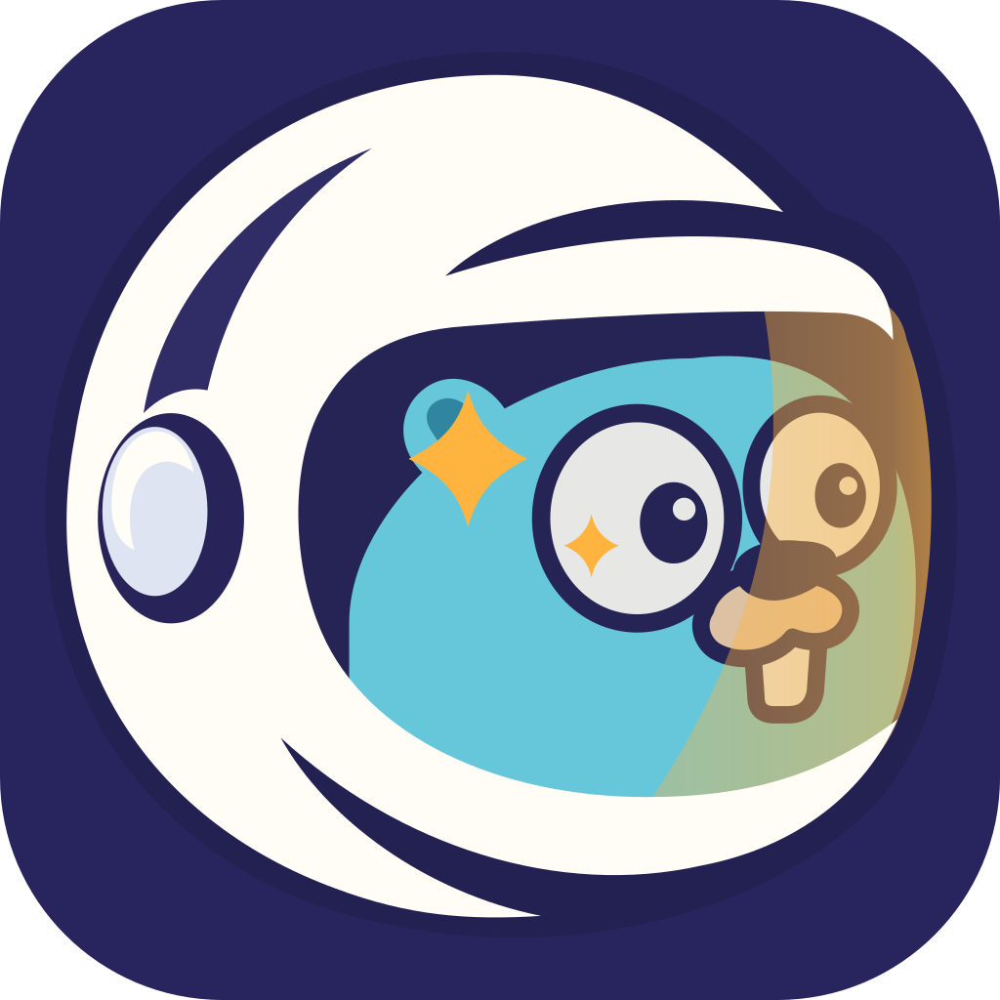
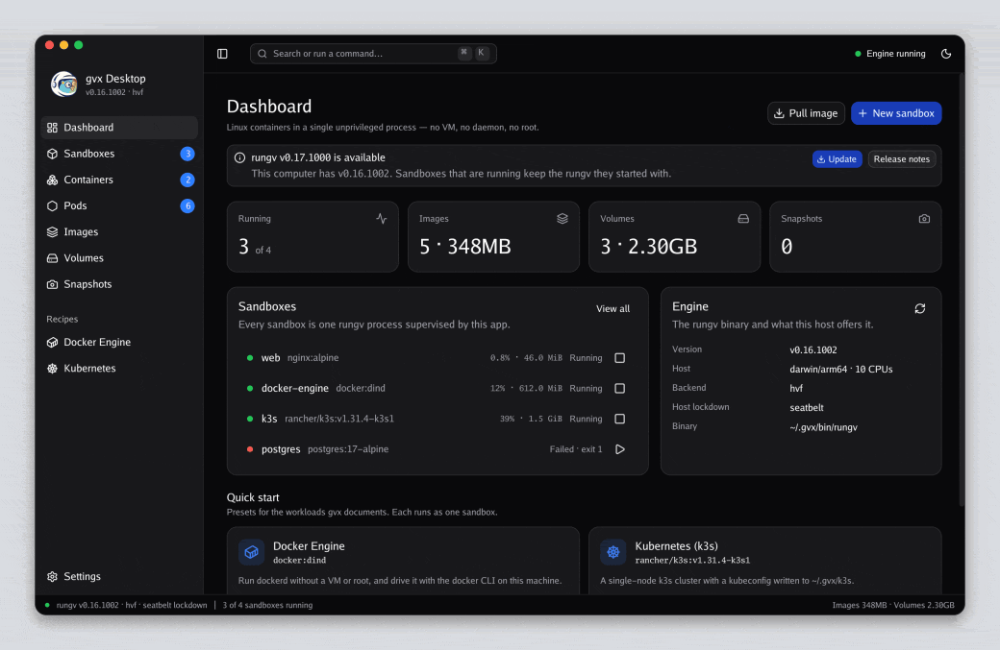

<p align="center">
  
</p>

<h1 align="center">gvx Desktop</h1>

<p align="center"><a href="README.md">English</a> · <b>한국어</b></p>

[gvx](https://github.com/gfire-sigs/gvx)를 위한 데스크톱 앱입니다. Linux 컨테이너를
권한 없는 gvx 샌드박스로 실행하고(VM도, 데몬도, root도 없이) 이미지·볼륨·스냅샷을
관리합니다. Docker Desktop과 같은 쓰임새를 지향하며,
[ggui](https://github.com/ironpark/ggui)로 만들었습니다.

<p align="center">
  
</p>

## 설치

Apple silicon Mac에서 [Homebrew](https://brew.sh)로 설치합니다.

```sh
brew install --cask ironpark/tap/gvx-desktop
```

또는 [릴리스](https://github.com/ironpark/gvx-desktop/releases)에서 디스크 이미지를
받아 앱을 응용 프로그램 폴더로 끌어다 놓습니다.

> [!IMPORTANT]
> 이 앱은 Apple Developer ID로 서명되어 있지 않아서, 내려받은 앱을 macOS가 열지
> 않습니다. *"손상되었기 때문에 열 수 없습니다"* 또는 *"Apple에서 확인할 수
> 없습니다"* 라는 경고가 뜹니다. 파일이 잘못된 것이 아닙니다. macOS는 브라우저로
> 받은 모든 파일에 격리(quarantine) 표시를 붙이고, 격리된 앱은 Apple의 공증을
> 받았을 때만 실행해 줍니다. 앱을 응용 프로그램 폴더로 복사한 뒤 이 표시를 한 번
> 지우면 됩니다.
>
> ```sh
> xattr -dr com.apple.quarantine "/Applications/GVX Desktop.app"
> ```
>
> macOS 14 이하에서는 앱을 Control-클릭해 **열기**를 선택해도 됩니다. macOS 15
> 이상에서는 한 번 열기를 시도한 뒤 **시스템 설정 → 개인정보 보호 및 보안 →
> 그래도 열기**에서 허용합니다. Homebrew로 설치하면 이 과정이 필요 없습니다.
> cask가 표시를 직접 지웁니다. 받은 파일을 확인하려면 릴리스에 함께 있는
> `.sha256` 파일과 대조하세요: `shasum -a 256 -c gvx-desktop-*.dmg.sha256`.

Windows에서는 [Chocolatey](https://chocolatey.org)로 설치할 수 있습니다. 릴리스의
`gvx-desktop.<버전>.nupkg`를 받은 폴더에서 아래를 실행하면 PC에 맞는 프로그램을 설치하고
시작 메뉴에 등록합니다.

```powershell
choco install gvx-desktop --source .
```

(패키지가 chocolatey.org에 등록된 뒤에는 `choco install gvx-desktop`만으로 됩니다.)
또는 같은 릴리스에서 PC에 맞는 zip을 받아(`windows-amd64`는 Intel·AMD,
`windows-arm64`는 Arm) 안의 `GVX Desktop.exe`를 실행합니다. gvx는 *Windows 하이퍼바이저
플랫폼* 기능으로 게스트를 실행하므로 이 기능을 켜 두어야 합니다.

gvx를 먼저 설치할 필요는 없습니다. 앱이 `rungv`를 설치하고 최신으로
유지합니다([rungv](#rungv) 참고). 다른 시스템에서는 [직접 빌드](#빌드와-실행)하세요.

## 기능

| 영역 | 할 수 있는 일 |
| --- | --- |
| 대시보드 | 엔진 상태, 실행 중·이미지·볼륨·스냅샷 개수, 레시피 빠른 시작 |
| 샌드박스 | 생성·편집(`rungv run …` 미리 보기 포함), 시작·중지·재시작, 필터가 있는 실시간 로그, 게시 포트(열기·복사), 복제, 삭제, 앱과 함께 시작 |
| 이미지 | 목록, Docker Hub·Quay 검색과 태그 선택, 가져오기(진행 상황 스트리밍), JSON 검사, 새 샌드박스에서 실행, 삭제, 정리 |
| 볼륨 | 사용 여부와 사용처가 보이는 목록, 생성(ext4lite/hostfs), 위치 보기, 삭제, 정리 |
| 스냅샷 | 실행 중인 샌드박스 체크포인트(중지 또는 계속 실행), 목록, 복원, 삭제 |
| Docker Engine | 클릭 한 번으로 `docker:dind`, `docker context` 설정, 내부 컨테이너 목록과 시작·중지·재시작·삭제 |
| Kubernetes | 클릭 한 번으로 단일 노드 k3s, kubeconfig 감지, kubectl 예시 |
| 엔진 | gvx 릴리스에서 `rungv` 설치 또는 gvx `main`을 소스에서 빌드, 새 버전 확인과 업데이트, 하이퍼바이저용 서명(macOS) |
| 데스크톱 | 메뉴 막대 트레이(macOS/Windows)와 창을 닫으면 Dock에서 숨김, 로그인 시 시작, 네이티브 메뉴, ⌘K 팔레트, ⌘1–7 이동, 단일 인스턴스, 라이트·다크·시스템 테마 |

## 동작 방식

gvx에는 데몬이 없고, Go SDK는 자신을 호출한 프로세스를 잠급니다. 그래서 앱은 gvx를
직접 불러오지 않습니다. 샌드박스마다 `rungv` 자식 프로세스 하나를 관리하면서 그
출력(`rungv: publishing …`, 준비 패턴, 종료 코드)을 해석하고, 관리 명령은
`--format json`으로 읽습니다. 앱을 종료하면(또는 SIGINT/SIGTERM을 받으면) 앱이 시작한
샌드박스를 모두 중지합니다.

```
internal/rungv      rungv CLI 래퍼: 위치 찾기, info/images/volumes/df, pull/rm/prune, 서명, 릴리스
internal/sandbox    Spec → rungv 인자, Supervisor(프로세스, 로그, 포트, 준비 상태, 체크포인트/복원)
internal/registry   Docker Hub·Quay 검색과 찾은 저장소의 태그
internal/dockerapi  dind Unix 소켓을 쓰는 최소한의 Docker Engine API 클라이언트
internal/recipes    Docker Engine·Kubernetes 프리셋
internal/store      사용자 설정 디렉터리의 sandboxes.json / settings.json
internal/ui         ggui 화면
```

## 빌드와 실행

Go 1.27 이상이 필요합니다.

```sh
go build -o bin/gvx-desktop .
./bin/gvx-desktop
```

로컬에 체크아웃한 ggui로 빌드하려면 `go.mod`가 아니라 `go.work`(git이 무시합니다)에
적습니다.

```sh
go work init . ../ggui ../ggui/icons/lucide
```

릴리스와 같은 방식으로 `build/GVX Desktop.app`과 디스크 이미지를 만들려면
[ggui 명령](https://github.com/ironpark/ggui/blob/main/docs/cli.md)을 씁니다.

```sh
ggui build --dmg
```

엔진 없이 데모 데이터로 모든 화면을 렌더합니다.

```sh
./bin/gvx-desktop -render-dir ./shots
./bin/gvx-desktop -render-dir ./shots-ko -render-lang ko
```

`-render-tour DIR`은 같은 방식으로 앱을 둘러보는 과정을 움직임이 담긴 프레임으로
그립니다. `assets/tour.sh`가 그 프레임을 ffmpeg로 묶어 위의 애니메이션을 만듭니다.

앱은 영어와 한국어로 표시됩니다. 시스템 언어를 따르며, 설정 → 언어에서 고를 수
있습니다. 한국어 문구는 `internal/ui/i18n_ko.go`에 있고 코드의 영어 문구가 키입니다.
한국어가 없는 문구가 있으면 테스트가 실패합니다. 이 README도 두 언어로 둡니다:
[README.md](README.md).

## rungv

앱은 `rungv`를 설정 → rungv 경로, `$GVX_RUNGV`, `PATH`, `~/.gvx/bin`, 앱 옆과 `./bin`
순으로 찾습니다. macOS에서 rungv에는 `com.apple.security.hypervisor` 권한이 있어야
합니다. 앱이 서명되지 않은 바이너리를 감지하고 서명할 수 있습니다(설정 → rungv 서명).

`rungv`를 찾지 못하면 대시보드가 설치를 제안합니다. 앱은 이 시스템에 맞는 최신
[gvx 릴리스](https://github.com/gfire-sigs/gvx/releases)를 내려받아 릴리스의
`SHA256SUMS`와 대조하고, `~/.gvx/bin`에 넣은 뒤 서명합니다. 시작할 때 GitHub에 최신
릴리스를 묻고(설정에서 끌 수 있습니다) 새 버전이 있으면 업데이트를 제안합니다.
설정 → 업데이트 확인으로 직접 물을 수도 있습니다. 업데이트는 쓰고 있는 `rungv`가
앱이 쓸 수 있는 일반 파일이면 그 자리를 교체하고, 아니면 `~/.gvx/bin`에 설치한 뒤
설정 → rungv 경로를 그쪽으로 바꿉니다. 실행 중인 샌드박스는 시작할 때의 `rungv`를
계속 씁니다.

설정 → 업데이트 → 채널에서 새 `rungv`를 어디서 가져올지 고릅니다. *릴리스*는 gvx가
배포한 빌드입니다. *main (소스 빌드)*는 gvx `main` 브랜치의 최신 커밋을 따라갑니다.
앱이 GitHub에 head 커밋과, 그것이 쓰고 있는 `rungv`보다 몇 커밋 앞서 있는지를 묻고,
이 컴퓨터에서 빌드합니다. gvx를 앱 데이터 폴더(`gvx-src`)에 클론하고 gvx의
`scripts/repro-build.sh`를 실행한 다음, 결과물을 설치하고 서명합니다. `git`과 Go가
필요하며, Dock에서 시작한 앱은 `PATH`가 짧기 때문에 `PATH`, 흔한 설치 위치, 로그인
셸 순으로 찾습니다. 첫 빌드는 gVisor를 컴파일하므로 몇 분 걸립니다.

## 릴리스

`ggui.toml`의 `version`을 바꾸고 `vX.Y.Z` 태그를 푸시합니다.
[릴리스 워크플로](.github/workflows/release.yml)가 Apple silicon용 앱을 빌드해 디스크
이미지를 태그의 릴리스로 올리고, `release/cask.sh`로 만든 cask를
[ironpark/homebrew-tap](https://github.com/ironpark/homebrew-tap)에 씁니다. amd64·arm64용
Windows 프로그램도 교차 빌드해 릴리스에 추가합니다. 이 zip을 설치하는 Chocolatey
패키지도 `release/choco.sh`로 만들어 함께 올립니다. 워크플로가
읽는 시크릿은 파일 머리말에 적혀 있습니다. 앱 아이콘과 사이드바의 마크는 `assets/`에
그려져 있고, `assets/svg2png.swift`가 PNG로 만듭니다.

## 테스트

```sh
go test -short ./...                       # 단위 테스트
go test ./internal/sandbox/                # + 실제 샌드박스 (동작하는 rungv 필요)
GVXD_DOCKER_TEST=1 go test ./internal/recipes/   # + docker:dind를 띄우고 API 조회
```
