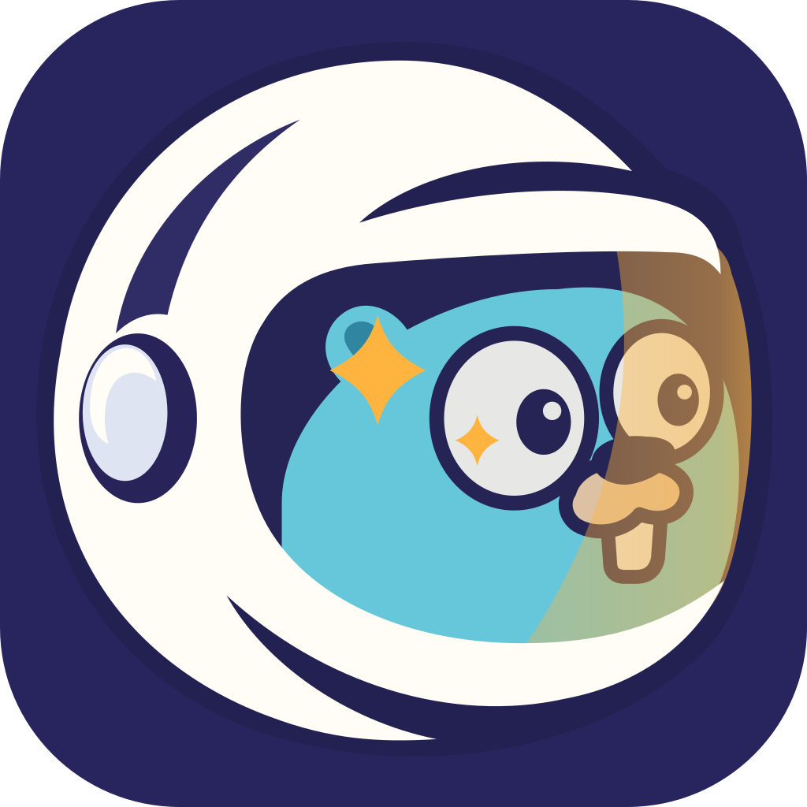
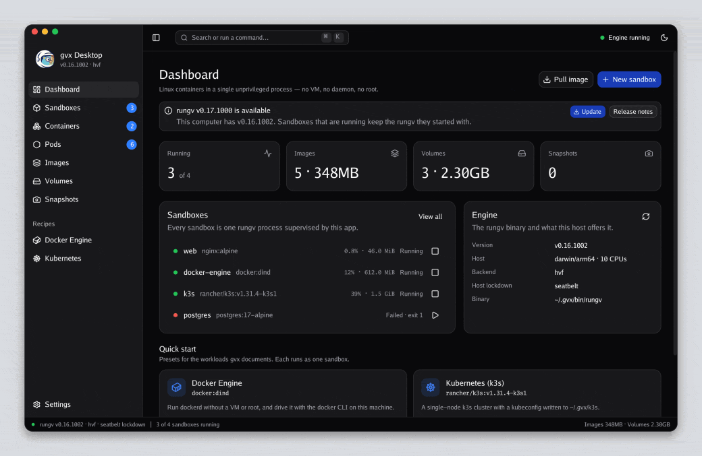

<p align="center">
  
</p>

<h1 align="center">gvx Desktop</h1>

<p align="center"><b>English</b> · <a href="README.ko.md">한국어</a></p>

A desktop app for [gvx](https://github.com/gfire-sigs/gvx) — run Linux containers as
unprivileged gvx sandboxes (no VM, no daemon, no root) and manage their images,
volumes and snapshots, in the spirit of Docker Desktop. Built with
[ggui](https://github.com/ironpark/ggui).

<p align="center">
  
</p>

## Install

On an Apple silicon Mac, with [Homebrew](https://brew.sh):

```sh
brew install --cask ironpark/tap/gvx-desktop
```

or take the disk image from the [releases](https://github.com/ironpark/gvx-desktop/releases).
gvx itself need not be there first: the app installs `rungv` and keeps it up
to date (see [rungv](#rungv)). On other systems, [build it](#build-and-run).

## Features

| Area | What you can do |
| --- | --- |
| Dashboard | Engine status, running/image/volume/snapshot counts, recipe quick start |
| Sandboxes | Create/edit (with a live `rungv run …` preview), start/stop/restart, live logs with filter, published ports (open/copy), duplicate, delete, start with the app |
| Images | List, search Docker Hub or Quay and choose a tag, pull (streaming progress), inspect JSON, run in a new sandbox, remove, prune |
| Volumes | List with in-use state and users, create (ext4lite/hostfs), reveal, delete, prune |
| Snapshots | Checkpoint a running sandbox (stop or keep running), list, restore, delete |
| Docker Engine | One-click `docker:dind`, `docker context` setup, inner container list with start/stop/restart/remove |
| Kubernetes | One-click single-node k3s, kubeconfig detection, kubectl snippets |
| Engine | Install `rungv` from gvx's releases or build gvx's `main` from source, see when a newer one is out and update to it, sign it for the hypervisor (macOS) |
| Desktop | Menu-bar tray (macOS/Windows), native menus, ⌘K palette, ⌘1–7 navigation, single instance, light/dark/system theme |

## How it works

gvx has no daemon, and its Go SDK locks down the process that calls it — so the
app never loads gvx itself. It supervises one `rungv` child process per sandbox,
parses its output (`rungv: publishing …`, ready patterns, exit codes) and reads
the management commands through `--format json`. Quitting the app (or SIGINT /
SIGTERM) stops every sandbox it started.

```
internal/rungv      rungv CLI wrapper: locate, info/images/volumes/df, pull/rm/prune, signing, releases
internal/sandbox    Spec → rungv args, Supervisor (processes, logs, ports, ready, checkpoint/restore)
internal/registry   Search of Docker Hub and Quay, and the tags of what it finds
internal/dockerapi  Minimal Docker Engine API client over the dind Unix socket
internal/recipes    Docker Engine and Kubernetes presets
internal/store      sandboxes.json / settings.json in the user config dir
internal/ui         ggui screens
```

## Build and run

Requires Go 1.27+.

```sh
go build -o bin/gvx-desktop .
./bin/gvx-desktop
```

To build against a local checkout of ggui, name it in a `go.work` (which git
ignores) rather than in `go.mod`:

```sh
go work init . ../ggui ../ggui/icons/lucide
```

Bundle it as the release does, into `build/gvx Desktop.app` and a disk image,
with the [ggui command](https://github.com/ironpark/ggui/blob/main/docs/cli.md):

```sh
ggui build --dmg
```

Render every screen with demo data, without an engine:

```sh
./bin/gvx-desktop -render-dir ./shots
./bin/gvx-desktop -render-dir ./shots-ko -render-lang ko
```

`-render-tour DIR` draws a walk through the app the same way, as frames with
its motion in them; `assets/tour.sh` makes the animation above of those, with
ffmpeg.

The app is worded in English and Korean. It follows the system language, and
Settings → Language chooses one. The Korean text lives in
`internal/ui/i18n_ko.go`, keyed by the English in the code; a test fails when
a text has no Korean. This README is kept in both too: [README.ko.md](README.ko.md).

## rungv

The app looks for `rungv` in Settings → rungv path, `$GVX_RUNGV`, `PATH`,
`~/.gvx/bin`, and next to the app / in `./bin`. On macOS rungv must carry the
`com.apple.security.hypervisor` entitlement; the app detects an unsigned binary
and can sign it (Settings → Sign rungv).

With no `rungv` to be found, the dashboard offers to install one: the app
downloads the newest [release of gvx](https://github.com/gfire-sigs/gvx/releases)
for this system, checks it against the release's `SHA256SUMS`, puts it in
`~/.gvx/bin` and signs it. At launch it asks GitHub for the newest release
(Settings turns that off) and offers the update when there is one; Settings →
Check for updates asks on demand. An update replaces the `rungv` in use when
it is a plain file the app may write, and otherwise goes to `~/.gvx/bin`, which
Settings → rungv path is then pointed at. Sandboxes that are running keep the
`rungv` they started with.

Settings → Updates → Channel chooses where a newer `rungv` comes from.
*Releases* are gvx's published builds. *main, built here* follows the newest
commit of gvx's `main` branch instead: the app asks GitHub for its head and how
many commits it is past the `rungv` in use, and builds it on this computer —
it clones gvx into the app's data folder (`gvx-src`), runs gvx's own
`scripts/repro-build.sh`, and installs and signs the result. That needs `git`
and Go, which are looked for on `PATH`, in the usual places and through the
login shell, since an app started from the Dock has a short `PATH`. The first
build compiles gVisor and takes minutes.

## Releasing

Set `version` in `ggui.toml` and push the tag `vX.Y.Z`. The
[release workflow](.github/workflows/release.yml) builds the app for Apple
silicon, publishes the disk image as the tag's release, and writes the cask
to [ironpark/homebrew-tap](https://github.com/ironpark/homebrew-tap) with
`release/cask.sh`; its header lists the secrets it reads. The icon and the
mark in the sidebar are drawn in `assets/`; `assets/svg2png.swift` makes
their PNGs.

## Tests

```sh
go test -short ./...                       # unit tests
go test ./internal/sandbox/                # + real sandboxes (needs a working rungv)
GVXD_DOCKER_TEST=1 go test ./internal/recipes/   # + boots docker:dind and queries its API
```
