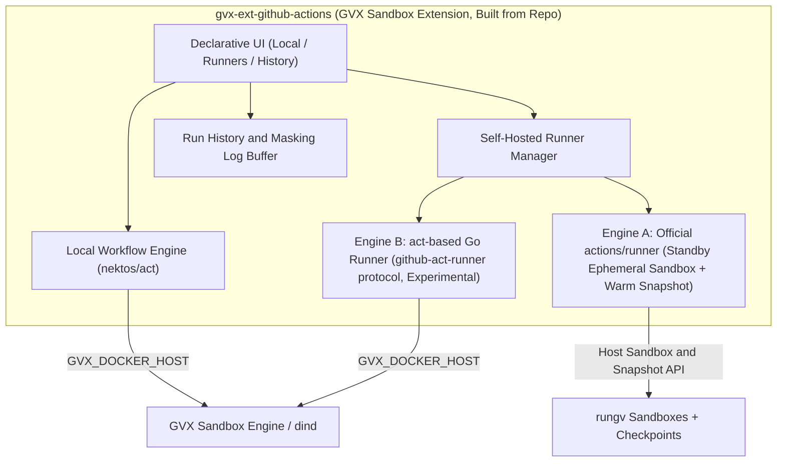

# GVX Desktop Extension API & GitHub Actions Extension 설계

Status: Draft design.

---

## 1. 개요 및 목표

GVX Desktop은 가벼운 순수 Go 데스크톱 앱(`CGO_ENABLED=0`, 재현 빌드, 최소 의존성 [`go.mod`](../../go.mod))을 지향합니다. `nektos/act`나 GitHub Self-Hosted Runner 같은 도메인 특화 기능을 앱 코어에 직접 내장하면 의존성과 유지보수 표면이 급격히 커지므로, **코어에는 범용 Extension API와 선언적 `ggui` 렌더러만 두고** 외부 확장(Extension)으로 구현할 수 있도록 설계합니다.

### 목표
1. **Sandbox-First 확장 런타임 (`rungv` + 내장 BuildKit)**: 확장은 기본적으로 격리된 **`rungv` 샌드박스(OCI 이미지)**로 실행합니다. 사전 빌드된 이미지 풀(`pull`)뿐 아니라 **Git 저장소(또는 로컬 소스 폴더)에서 `Dockerfile`을 직접 빌드**해 설치·업데이트할 수 있게 하여, OS별 바이너리 크로스빌드/코드서명/레지스트리 푸시 부담을 없앱니다. 개발 중 빠른 반복을 위해 Developer Mode에서만 로컬 `binary` 런타임을 보조로 허용합니다.
2. **네이티브 선언적 UI (`ggui`)**: WebView 없이 `../mako`에서 검증된 선언적 UI 트리 어휘(`internal/uiblock`)를 도입해, 확장이 앱의 테마·단축키·레이아웃과 100% 일치하는 네이티브 UI를 그리게 합니다.
3. **커널 수준 권한·시크릿 격리**: `rungv` gVisor 샌드박스로 파일시스템·네트워크 권한(`-net none` vs `-net nat`, 승인된 폴더만 마운트)을 실제로 강제하고, Host API(Docker, Sandbox, Snapshot, Secrets, UI Intent)를 매니페스트와 사용자 승인으로 엄격히 통제합니다.
4. **1차 검증 타깃 (`gvx-ext-github-actions`)**: 본 Extension API 위에 **로컬 워크플로우 실행(`nektos/act`)**과 **GitHub.com Self-Hosted Runner** 두 기능을 하나의 외부 확장(Git 저장소 빌드 가능)으로 구현합니다.

### 비목표 (v1)
- 중앙 확장 마켓플레이스/원격 서명 카탈로그 서버 (v1은 Git 저장소 빌드 + 로컬 소스 폴더 빌드 + OCI 이미지 참조에 집중)
- 인프로세스 Go `plugin` 또는 내장 WebView
- QuickJS-on-Wasm(`qngg`) 런타임 내장 (필요 시 v2에서 `runtime.type = "wasm"`으로 추가 가능하도록 프로토콜만 호환 유지)

---

## 2. `../mako` 플러그인 시스템 분석 및 차용 전략

동일한 `ggui` 기반인 `../mako`의 플러그인 아키텍처(`internal/uiblock`, `internal/plugin`, `internal/gui/pluginui.go`, `pluginblock.go`)는 이미 선언적 네이티브 UI, 권한 승인, 키체인 시크릿 볼트, 폼 상태 보존 등의 난제를 해결했습니다.

| 영역 | `../mako` 구현 | GVX Desktop 적용 방침 | 비고 |
| :--- | :--- | :--- | :--- |
| **선언적 UI 어휘 & 검증** | `internal/uiblock/tree.go` (35종 노드, 512 KiB / 2000노드 / 깊이 24 제한, 토큰 `tone`, raw hex 금지, Spoofing 문자 차단) | **핵심 구조 그대로 차용** | `toolbar` 크롬 리프팅, `scroll(variant="follow")` 로그 자동 추적, `split(direction="auto")`, `dialog`, `contextMenu`, `dag`(워크플로우 Job 그래프!)까지 CI UI에 최적 |
| **폼 상태 & 이벤트 검증** | `uiblock/event.go` + `gui/pluginblock.go` (`blockForm`, `Tree.Message`, `Tree.Values`) | **그대로 차용** | 재렌더 시 입력 중 텍스트 유실 방지, 버튼 클릭 시 현재 폼 값 동반 전송, 마지막 렌더 트리 기준 노드 ID·타입 검증 |
| **증분 업데이트 스트림** | `uiblock/follow.go` (`Follow` — 최초 전체 트리, 이후 100ms 코얼레싱 Diff 패치) | **그대로 차용** | CI 로그/상태가 빠르게 바뀔 때 UI 프레임 드랍 방지 |
| **권한 승인 상태 머신** | `internal/plugin/permissions.go` (`waiting` → 사용자 Grant, 권한 추가 시 재승인) | **그대로 차용** | `gvx-` 예약 접두사(향후 번들 확장용), 중복/미등록 권한 거부 |
| **시크릿 볼트** | `internal/plugin/secrets.go` (OS 키체인 + `secrets-index.json` + `0600` 파일 폴백) | **그대로 차용** | UI에는 `isSet: bool`만 전달, 로그/트리에 시크릿 노출 차단, 삭제 시 인덱스 기반 완전 정리 |
| **선언적 Settings** | `[contributes.settings]` (`string`, `secret`, `boolean`, `number`, `select`) | **그대로 차용** | 호스트가 `Settings ▸ Extensions` 화면을 자동 생성 |
| **Gesture-Gated UI Intent** | `plugin.go`의 `gesture` 플래그 (사용자 조작 핸들러에서만 `openUrl`, `copy` 등 허용) | **그대로 차용** | 백그라운드 폴링 중 무단 터미널 오픈·폴더 피커 팝업 방지 |
| **i18n 로케일 전달** | `locale` 기반 fallback (`ko-kr` → `ko` → `en`) | **그대로 차용** | GVX Desktop의 7개 언어 설정과 연동 |
| **MCP 도구 기여** | `[[contributes.tool]]` | **차용 (기존 `internal/mcpserver` 연동)** | 활성화·승인된 확장의 도구를 내장 MCP 서버에 동적 등록 |
| **실행 런타임** | QuickJS-on-Wasm (`qngg`), 호출당 CPU 2s / Wall 30s 제한 | **변경: `sandbox` (`rungv` OCI, 기본) + Dev `binary`** | `nektos/act`, GitHub long-polling, 장기 실행 러너를 gVisor 격리 상태에서 실행; 내장 BuildKit으로 Git 저장소에서 직접 빌드 지원 |
| **매니페스트 형식** | `plugin.toml` (`BurntSushi/toml`) | **동일하게 `extension.toml` 채택** | 이 저장소의 `ggui.toml` 및 `../mako`의 `plugin.toml`과 일관성 유지; `BurntSushi/toml`의 `md.Undecoded()`로 미등록 키 엄격 거부 |

---

## 3. 디렉토리 및 경로 레이아웃

확장 관련 파일은 `~/.gvx`가 아닌 **GVX Desktop 자체 데이터 디렉토리**(`store.DefaultDir()`, `-data-dir` 플래그로 오버라이드 가능) 하위에 저장합니다.

- macOS: `~/Library/Application Support/gvx-desktop/`
- Linux: `~/.config/gvx-desktop/` (또는 `$XDG_CONFIG_HOME/gvx-desktop/`)
- Windows: `%AppData%\gvx-desktop\`

```text
<dataDir>/                                  # store.DefaultDir() 또는 -data-dir
├── settings.json
├── sandboxes.json
├── engine/                                 # 기존 Sandbox Engine 스토어
├── extension-grants.json                   # 사용자 권한 승인, 승인된 호스트 폴더, 활성화 상태 (확장 쓰기 불가)
├── extensions/                             # 설치된 확장 메타데이터 및 소스 체크아웃 (확장 쓰기 불가)
│   └── <ext-id>/
│       ├── extension.toml                  # 검증된 매니페스트 스냅샷
│       ├── source.json                     # 설치 소스(repo URL/ref/commit SHA, image ref, 또는 local path) 및 빌드된 이미지 ID
│       └── src/                            # Git 저장소 설치 시 체크아웃 디렉토리 (로컬 경로 설치 시 미생성)
└── extension-data/                         # 확장별 영속 데이터 (언인스톨 시 선택 정리)
    └── <ext-id>/
        ├── settings.json                   # 비시크릿 설정값
        ├── storage.json                    # KV 스토어 (최대 4 MiB)
        ├── secrets-index.json              # 키체인 등록 키 목록 (값 없음)
        ├── secrets.json                    # 키체인 미지원 환경 폴백 (0600)
        ├── files/                          # 확장 전용 작업 디렉토리 (GVX_EXT_DATA_DIR)
        └── logs/                           # 확장 stderr/구조화 로그 (로테이션)
```

### 런타임 IPC 소켓 경로 (`sun_path` 104바이트 제한 대응)
macOS의 `~/Library/Application Support/gvx-desktop/...` 경로는 길이가 길어 Unix 도메인 소켓 `sun_path` 제한(104바이트)을 쉽게 초과합니다(`docs/design/amd64-builder.md` 및 `internal/engine/engine.go`의 `BuilderSocketDir`와 동일한 제약).

- **Unix (macOS / Linux)**: `<os.TempDir()>/gvxd-ext-<uid>-<sha256(dataDir)[:8]>/` (`0700`) 하위에 짧은 파일명으로 생성
  - Host API 소켓: `h-<short>.sock`
  - Docker 스코프 프록시 소켓: `d-<short>.sock`
  - Extension API 소켓: `e-<short>.sock`
- **Windows**: `127.0.0.1:0` 루프백 TCP 리스너 (모든 요청에 256-bit 랜덤 Bearer 토큰 필수 검증)

---

## 4. 매니페스트 스키마 (`extension.toml`) 및 권한 모델

### 4.1 스키마 예시

```toml
schema_version = 1
id = "github-actions"
version = "0.1.0"
publisher = "ironpark"
name = "GitHub Actions"
description = "Run GitHub Actions workflows locally with act and host isolated GVX self-hosted runners."
icon = "workflow"

permissions = [
  "docker",
  "sandboxes",
  "snapshots",
  "secrets",
  "storage",
  "ui:pick-folder",
  "ui:terminal",
  "network",
]

[runtime]
type = "sandbox"                            # 기본: "sandbox" ("binary"는 Developer Mode 전용)
# 저장소 빌드 설정 (repo/local 설치 시 내장 BuildKit으로 자동 빌드)
dockerfile = "Dockerfile"                   # 기본값: "Dockerfile" (저장소 루트 기준 상대 경로)
context = "."                               # 기본값: "." (저장소 루트 기준 상대 경로)
target = ""                                 # 선택: 멀티스테이지 빌드 타깃
# 사전 빌드된 이미지 (선택: 사용자가 "Prebuilt image" 채널 선택 시 pull)
image = "ghcr.io/ironpark/gvx-ext-github-actions:0.1.0"
# 샌드박스 내부 Extension API 포트 (호스트가 -p unix:<ext.sock>:<port>로 연결)
port = 18900
memory = "512m"                             # 선택: 확장 자체 샌드박스 메모리 상한 (기본 512m)
cpus = "1"                                  # 선택: CPU 상한
idle_timeout_sec = 0                        # 0 = 상주, >0 = 유휴 자동 중지
# Developer Mode에서 로컬 바이너리로 직접 실행할 때만 사용 (선택)
dev_entrypoint = "bin/gvx-ext-github-actions"

[[contributes.view]]
id = "main"
title = "GitHub Actions"
icon = "workflow"
chrome = "toolbar"

[[contributes.command]]
id = "run-local"
title = "Actions: Run Local Workflow…"

[[contributes.command]]
id = "add-runner"
title = "Actions: Add Self-Hosted Runner…"

[[contributes.tool]]
id = "list_runners"
description = "List configured GitHub self-hosted runners and their status."

[[contributes.tool]]
id = "run_local_workflow"
description = "Run a local GitHub Actions workflow using act."
[contributes.tool.params]
repo_path = { type = "string", description = "Local repository path", required = true }
workflow = { type = "string", description = "Workflow file name", required = false }
job = { type = "string", description = "Specific job ID", required = false }

[contributes.settings]
default_act_image = { type = "string", label = "Default act runner image", description = "Container image mapped to ubuntu-latest when running locally.", default = "catthehacker/ubuntu:act-latest" }
default_concurrency = { type = "number", label = "Default runner concurrency", default = 1 }
github_pat = { type = "secret", label = "Default GitHub Token (PAT)", description = "Optional token for generating ephemeral runner JIT configs." }
```

### 4.2 엄격한 매니페스트 검증 규칙 (`../mako` 규칙 계승)
- 최대 파일 크기 `64 KiB`, `github.com/BurntSushi/toml`로 파싱 후 `len(md.Undecoded()) > 0`이면 알 수 없는 키로 즉시 거부.
- `id`: `^[a-z0-9](?:[a-z0-9-]{0,62}[a-z0-9])?$`, 디렉토리 이름과 반드시 일치. `gvx-` 접두사와 `publisher: "gvx"`는 향후 퍼스트파티 번들 확장용으로 예약.
- `version`: SemVer (`major.minor.patch[-pre]`).
- `runtime.dockerfile`, `runtime.context`, `runtime.dev_entrypoint`: 저장소/확장 디렉토리 내부 상대 경로만 허용 (`..`, 선행 `/`, `\` 금지, 심볼릭 링크 탈출 검사).
- `runtime.type == "sandbox"`일 때 `dockerfile` 또는 `image` 중 최소 하나가 있어야 합니다. `port`는 `1024..65535` 범위(기본 `18900`).
- 모든 제목·라벨·옵션 문자열에 제어 문자 및 Unicode 방향 제어(bidi spoofing) 문자 금지.
- 상한: `permissions <= 16`, `views <= 8`, `commands <= 32`, `tools <= 16`, `settings <= 32`.

### 4.3 권한 카탈로그 및 승인 상태 머신

**암묵적 권한** (선언 불필요): 자기 자신의 `views`/`settings`/`logs` 접근, `host/info` 조회, `ui:toast` 알림.

| 권한 | 허용되는 Host API | 위험도 |
| :--- | :--- | :--- |
| `storage` | 확장 전용 KV 스토어 (`/v1/storage/*`) | 낮음 |
| `secrets` | 확장 전용 OS 키체인 볼트 (`/v1/secrets/*`) | 중간 |
| `docker` | 스코프 Docker API 소켓 (`GVX_DOCKER_HOST`) 접근 | 높음 |
| `sandboxes` | `rungv` 샌드박스 생성/시작/중지/exec/로그/삭제 (확장 소유 샌드박스 우선) | 높음 |
| `snapshots` | 확장 소유 샌드박스의 체크포인트 스냅샷 생성/목록/복원/삭제 | 중간 |
| `ui:pick-folder` | Gesture-gated 네이티브 폴더 선택 다이얼로그 | 낮음 |
| `ui:terminal` | Gesture-gated GVX Desktop 내장 터미널로 컨테이너/샌드박스 쉘 오픈 | 중간 |
| `ui:open-url` | Gesture-gated 외부 `http(s)://` URL 오픈 | 낮음 |
| `localproxy` | `https://<ext-id>.localhost` 선택적 웹 UI 라우트 등록 | 중간 |
| `network` | 확장 프로세스의 외부 네트워크 접근 의도 고지 (`binary`는 고지/감사 목적, `sandbox`는 `-net nat` vs `-net none` 실제 격리 적용!) | 중간 |

**상태 머신**:
```text
discovered ─► invalid (매니페스트/소스 오류)
           ─► waiting (미승인 권한 또는 최초 빌드 확인 대기; UI에서 소스/커밋/권한 검토 후 Allow & Build 클릭)
           ─► building (내장 BuildKit으로 Dockerfile 빌드 또는 OCI 이미지 pull 진행 중; 실시간 빌드 로그 표시)
           ─► disabled (사용자가 끔)
           ─► starting ─► running ─► degraded / crashed (백오프 재시작, 3회 연속 실패 시 failed 정지)
```
- 확장이 업데이트되어 **새 권한을 하나라도 추가 요청**하거나, **새 커밋/버전으로 재빌드**해야 하면 즉시 실행을 중단하고 `waiting` 상태로 전환해 변경된 권한/커밋 diff 승인을 요구합니다.

---

## 5. 확장 설치·빌드·런타임 및 생명주기

### 5.1 3가지 설치 소스 (모두 `sandbox` 실행으로 수렴)

확장 개발자는 컨테이너 레지스트리에 이미지를 푸시하지 않아도 **Git 저장소에 `extension.toml` + `Dockerfile` + 소스 코드만 올리면** 배포할 수 있습니다.

| 설치 방식 | 입력 예시 | 동작 흐름 |
| :--- | :--- | :--- |
| **1. Git 저장소 빌드 (1급 지원)** | `https://github.com/ironpark/gvx-ext-github-actions` (선택: `@v0.1.0` 또는 `@main`) | `src/`로 shallow clone → `extension.toml` 검증 → **사용자에게 저장소/커밋 SHA/권한 확인** → 승인 후 내장 BuildKit(`POST /build`)으로 `Dockerfile` 빌드 → 로컬 태그 `gvx-ext/<id>:<ver>-<shortsha>` 생성 → `rungv` 샌드박스 실행 |
| **2. 로컬 소스 폴더 빌드 (개발/오프라인)** | `/Users/me/Projects/gvx-ext-github-actions` | 로컬 폴더에서 `extension.toml` 읽기 → 승인 → BuildKit으로 즉시 빌드·재빌드(캐시 활용) |
| **3. 사전 빌드 OCI 이미지 (선택)** | `ghcr.io/ironpark/gvx-ext-github-actions:0.1.0` (또는 저장소 내 `runtime.image` 채널 선택) | 빌드 없이 `rungv pull`로 즉시 설치 (`rungv` 업데이트의 *Releases* vs *main, built here* 채널과 동일한 UX) |

#### 저장소 빌드 세부 설계 (`internal/engine/build.go` 재사용)
- **격리된 빌드**: 빌드는 호스트 쉘이 아니라 GVX Desktop의 **lazy BuildKit 빌더 샌드박스**(`internal/engine/build.go`의 `POST /build`, 호환 모드에서는 `docker:dind`의 `POST /build`) 안에서 수행됩니다. 호스트에 Go/Node/Rust 툴체인이 전혀 설치되어 있지 않아도 멀티스테이지 `Dockerfile`로 빌드됩니다.
- **빌드 전 승인 원칙**: `Dockerfile`의 `RUN` 단계도 코드 실행이므로, `git clone` 직후 자동 빌드하지 않고 **반드시 사용자가 저장소 URL, 커밋 SHA, `Dockerfile` 위치, 요청 권한을 확인하고 승인(`Allow & Build`)한 뒤** 빌드를 시작합니다.
- **컨텍스트 패키징 & 보안**:
  - 저장소 루트의 `.dockerignore`를 존중하고 `.git/`은 기본 제외해 tar 스트림으로 전송합니다(`maxBuildContextBytes = 512 MiB` 준수).
  - `context`·`dockerfile`이 심볼릭 링크를 포함해 저장소 루트 밖을 참조하면 빌드를 거부합니다.
  - 빌드 플랫폼은 현재 호스트 `rungv` 아키텍처(`linux/arm64` 또는 `linux/amd64`)로 고정해 네이티브 성능으로 실행합니다.
- **업데이트 흐름**:
  - `Check for updates` → 원격 브랜치/태그 `git ls-remote` 확인 → 업데이트 발견 시 `git fetch` → 변경된 커밋 로그 + 권한 diff 표시 → 사용자 승인 시 BuildKit 캐시 재사용으로 수 초 내 재빌드 → 기존 샌드박스 중지 후 새 이미지로 교체(이전 이미지는 롤백용 1개 유지 또는 정리).
- **이미지 정리 보호**: `internal/engine/engine.go`의 `Config.KeepImages` 콜백에 활성 확장 이미지 목록(`gvx-ext/<id>:...`)을 포함시켜, `docker image prune` 시 확장 이미지가 실수로 삭제되지 않도록 보호합니다.

### 5.2 두 가지 런타임 모드 (`sandbox` 기본 + Developer Mode `binary`)

| 항목 | `type = "sandbox"` (기본·표준) | `type = "binary"` (Developer Mode 전용) |
| :--- | :--- | :--- |
| 실행 주체 | `internal/sandbox.Supervisor` (`rungv run`) | `exec.CommandContext` 자식 프로세스 (`dev_entrypoint`) |
| 파일시스템 격리 | **gVisor 격리**: `extension-data/<id>/files` → `/data`, 사용자가 `ui:pick-folder`로 승인한 폴더만 마운트 | 호스트 사용자 권한 (UI에 `Dev · Unsandboxed` 배지 상시 표시) |
| 네트워크 격리 | **`network` 권한 없으면 `-net none` 실제 차단**, 있으면 `-net nat` | 호스트 네트워크 (격리 없음) |
| Host API 연결 | `--unix-forward <host.sock>:/run/gvx/host.sock` (`GVX_HOST_API=unix:///run/gvx/host.sock`) | `GVX_HOST_API=unix:///tmp/.../h-xxx.sock` (Windows: `http://127.0.0.1:<port>`) |
| Docker API 연결 | `docker` 권한 시 `--unix-forward <docker-scope.sock>:/run/gvx/docker.sock` (`GVX_DOCKER_HOST=unix:///run/gvx/docker.sock`) | `GVX_DOCKER_HOST=unix:///tmp/.../d-xxx.sock` |
| Extension API 수신 | `-p unix:<ext.sock>:<runtime.port>` (게스트는 `0.0.0.0:<port>` 리슨) | `GVX_EXT_LISTEN=unix:///tmp/.../e-xxx.sock` |

> **Windows 대응**: `rungv`의 `-p unix:...`와 `--unix-forward` 지원 여부에 따라 Windows에서는 `127.0.0.1:<port>` + 게스트 루프백(`10.0.2.2:<port>`, `engine/build.go`의 `guestHostLoopback`) + per-session 256-bit Bearer 토큰으로 동일 프로토콜을 투명하게 폴백합니다.

### 5.3 샌드박스 확장의 호스트 로컬 폴더 접근 (`pick-folder` → 동적 마운트)
`gvx-ext-github-actions`처럼 `sandbox` 안에서 로컬 Git 저장소(`/Users/me/Projects/my-app`)를 읽고 `nektos/act`로 Docker 컨테이너에 마운트해야 하는 경우를 다음 규칙으로 해결합니다.
1. 확장이 사용자 제스처 중에 `POST /v1/ui/pick-folder`를 호출합니다.
2. 사용자가 OS 폴더 피커에서 폴더를 선택하면, 호스트는 해당 절대 경로를 `extension-grants.json`의 `allowed_folders`에 영구 기록합니다(사용자는 `Settings ▸ Extensions`에서 언제든 개별 폴더 접근 권한을 해제 가능).
3. 호스트는 해당 폴더를 확장 샌드박스에 **호스트와 동일한 경로**(`/Users/me/Projects/my-app:/Users/me/Projects/my-app`, Windows는 `/c/Users/me/...`, `internal/recipes/shared.go`의 `WithSharedFolders` 규칙과 동일)로 마운트하기 위해 확장 샌드박스를 투명하게 재시작합니다(UI 상태는 `storage.json`에 보존).
4. **스코프 Docker 프록시 검증**: 확장이 `GVX_DOCKER_HOST`로 `POST /containers/create`를 보낼 때 `HostConfig.Binds`의 호스트 경로가 `allowed_folders` 또는 `extension-data/<id>/files` 하위인지 검증해, 확장이 승인받지 않은 호스트 경로(예: `~/.ssh`)를 Job 컨테이너에 몰래 마운트하는 것을 원천 차단합니다!

### 5.4 시작·헬스체크·종료
1. **시작 (`Start`)**:
   - 호스트가 per-session 랜덤 256-bit 토큰 2개 생성: `GVX_HOST_TOKEN`(확장 → 호스트), `GVX_EXT_TOKEN`(호스트 → 확장).
   - 환경변수 주입 후 샌드박스(또는 Dev 바이너리) 실행:
     - `GVX_API_VERSION=1`
     - `GVX_EXT_ID=<id>`
     - `GVX_HOST_API=<unix:///run/gvx/host.sock 또는 http://10.0.2.2:...>`
     - `GVX_HOST_TOKEN=<token>`
     - `GVX_EXT_LISTEN=<0.0.0.0:18900 또는 unix://...>`
     - `GVX_EXT_TOKEN=<token>`
     - `GVX_DOCKER_HOST=<unix:///run/gvx/docker.sock 또는 http://10.0.2.2:...>` (`docker` 권한 승인 시에만 전달)
     - `GVX_EXT_DATA_DIR=/data` (Dev 바이너리는 `<dataDir>/extension-data/<id>/files`)
   - `GET /v1/health`가 200 OK를 응답할 때까지 폴링 (최대 15초).
2. **유휴 종료 (`idle_timeout_sec`)**:
   - `0`이면 앱이 켜져 있는 동안 상주(Self-Hosted Runner처럼 백그라운드 폴링이 필요한 확장).
   - `> 0`이면 활성 뷰 구독/백그라운드 작업이 없을 때 유휴 타임아웃 후 자동 종료하여 메모리 절약.
3. **종료 (`Shutdown`)**:
   - `main.go` 종료 시퀀스(`m.CloseTerminals()`, `m.CloseForwards()` 직후, `StopAll`/`CloseSandboxEngine` 이전)에 `m.CloseExtensions(8 * time.Second)`를 연결합니다.
   - `POST /v1/shutdown` 전송 (최대 5초 대기) → 샌드박스 graceful stop / `SIGTERM` (최대 3초) → 강제 종료.
   - 확장이 생성한 임시 샌드박스 중 `ephemeral: true` 표시된 것은 호스트가 강제 정리합니다.

---

## 6. 양방향 통신 프로토콜

별도 RPC 프레임워크/코드젠 없이 **HTTP/1.1 + JSON + SSE**로 통일합니다. 모든 요청은 `Authorization: Bearer <token>`을 검증하며, 크로스 오리진/DNS 리바인딩 방지를 위해 Unix 소켓 또는 `127.0.0.1` 루프백만 바인드합니다.

### 6.1 Host API (Extension → GVX Desktop)

#### 시스템 & 설정
- `GET /v1/host/info`
  - 응답: `{ app_version, os, arch, locale, theme, docker_mode: "sandbox"|"dind"|"off", docker_ready, rungv_version }`
- `GET /v1/settings`
  - 비시크릿 설정값 맵 반환. `secret` 타입 설정은 `{ "github_pat": { "set": true } }` 형태로 여부만 반환(실제 값은 `/v1/secrets/setting:<key>`로 `secrets` 권한 검사 후 조회).

#### 스토리지 & 시크릿 (`internal/keychain` + `vault`)
- `GET /v1/storage?prefix=...`, `GET/PUT/DELETE /v1/storage/{key}` (확장당 4 MiB, 키 길이 ≤ 128B)
- `GET /v1/secrets` (키 이름 목록), `GET/PUT/DELETE /v1/secrets/{key}` (`secrets` 권한 필요, 값 ≤ 2048B, 분당 60회 레이트 제한)
  - **OS 키체인 백엔드 (`internal/keychain`)**: `../mako/internal/keychain`과 동일하게 **CGO 없이(`CGO_ENABLED=0`)** macOS Keychain / Linux Secret Service(D-Bus) / Windows Credential Manager를 Phase 1부터 직접 연동합니다.
  - 키체인 서비스명: `"gvx-desktop extension <id> (<sha256(dataDir)[:8]>)"`
  - 안전장치:
    - `testing.Testing()` 시 시스템 키체인 접근 차단(`keychain.Fake` 사용)
    - `GVX_KEYCHAIN=file` 환경변수로 헤드리스/테스트 하네스 강제 파일 폴백 지원
    - 키체인 호출별 `20s` 타임아웃(`ErrTimeout`)으로 잠긴 키체인 프롬프트 행 방지
    - 키체인 미지원 환경에서는 `0600` 권한의 `secrets.json` 폴백 + UI에 명시적 표시, 추후 키체인 가용 시 자동 마이그레이션
    - `secrets-index.json`에 키 이름 목록만 기록해 확장 삭제 시 키체인 항목을 빠짐없이 정리

#### 스코프 Docker API (`GVX_DOCKER_HOST`, `docker` 권한 필요)
- `internal/dockerproxy` 앞에 경량 HTTP 래퍼를 두어:
  - `POST /containers/create` 요청 시 `Labels["io.gvx.extension"] = <ext-id>` 자동 주입 (이미 다른 확장 라벨이 있으면 거부).
  - **바인드 마운트 경로 검증**: `HostConfig.Binds` / `Mounts`의 호스트 경로가 해당 확장의 `allowed_folders` 또는 `extension-data/<id>/files` 하위인지 검사해 미승인 호스트 경로 접근을 차단.
  - GVX Desktop의 Containers 화면에서 어떤 확장이 띄운 컨테이너인지 배지로 표시 가능.
  - Docker Engine(`sandbox` 또는 `dind`)이 꺼져 있으면 명확한 503 에러 반환 (또는 사용자 설정에 따라 자동 시작 요청).

#### Sandbox & Snapshot API (`sandboxes`, `snapshots` 권한 필요)
`internal/mcpserver`의 `Backend` 메서드를 확장 소유권 스코프로 감싸 노출합니다.
- `GET /v1/sandboxes?owned=true` — 확장이 생성한 샌드박스 목록 (`Spec.Labels["io.gvx.extension"] == <id>` 또는 전용 네임스페이스)
- `POST /v1/sandboxes` — 새 샌드박스 생성·시작 (`name`, `image`, `command`, `env`, `ports`, `mounts`, `memory`, `cpus`, `checkpoint`, `ephemeral`, `mount_docker_sock` *(별도 `docker` 권한 필요)*)
- `POST /v1/sandboxes/{id}/start|stop|delete`
- `POST /v1/sandboxes/{id}/exec` — 명령 실행 (`argv`, `workdir`, `env`, `timeout_sec`) → `{ exit_code, stdout, stderr, truncated }`
- `GET /v1/sandboxes/{id}/logs?tail=200&follow=true` — 일반 조회 또는 SSE 스트리밍
- `POST /v1/sandboxes/{id}/snapshots` — 체크포인트 생성 (`name`, `leave_running`)
- `GET /v1/sandboxes/{id}/snapshots` — 스냅샷 목록
- `POST /v1/sandboxes/{id}/restore` — 지정 스냅샷에서 복원 (`snapshot`, 선택적 새 `env` 주입 또는 복원 후 `exec` 실행)
- `DELETE /v1/sandboxes/{id}/snapshots/{name}`

> **보안 경계**: 확장은 기본적으로 **자신이 생성한(`owned`) 샌드박스/스냅샷**만 변경·삭제·exec할 수 있어, 사용자의 일반 샌드박스나 `k3s`/`docker-engine` 레시피를 침범하지 못합니다.

#### UI 브릿지 & 이벤트
- `POST /v1/ui/badge` — 사이드바 배지 갱신 `{ text: "2", tone: "accent"|"success"|"warning"|"danger", tooltip: "2 jobs running" }`
- `POST /v1/ui/toast` — 알림 토스트 `{ level, message }` (분당 12회 제한)
- `POST /v1/ui/pick-folder` — **Gesture-only**, `ui:pick-folder` 권한 필요 → `{ cancelled: bool, path: string }`
- `POST /v1/ui/open-terminal` — **Gesture-only**, `ui:terminal` 권한 필요 → `{ target_type: "container"|"sandbox", target_id: string, shell?: string }`
- `POST /v1/ui/open-url` — **Gesture-only**, `ui:open-url` 권한 필요 (`http://` 또는 `https://`만 허용)
- `POST /v1/ui/copy` — **Gesture-only**, 클립보드 복사 (UTF-8 ≤ 64 KiB)
- `GET /v1/events` (SSE) — `host.theme`, `host.locale`, `docker.state`, `sandbox.state`(소유분), `settings.changed`, `app.stopping`

> **Gesture 토큰 전달 방식**: 사용자가 UI 이벤트(`POST /v1/views/{id}/event`)나 커맨드(`POST /v1/commands/{id}`)를 트리거할 때, 호스트가 단기 유효한 `X-GVX-Gesture-ID`를 요청 헤더로 전달합니다. 확장은 해당 요청을 처리하는 동안 이 헤더를 Host API 호출에 되돌려 보내야만 gesture-gated API(`pick-folder`, `open-terminal`, `open-url`, `copy`)가 허용됩니다.

### 6.2 Extension API (GVX Desktop → Extension)

| 엔드포인트 | 설명 |
| :--- | :--- |
| `GET /v1/health` | `{ "status": "ok", "version": "0.1.0" }` |
| `GET /v1/views/{viewId}/stream?locale=ko` | **SSE 스트림**. 최초 이벤트로 `event: tree` (전체 `UiNode` JSON) 전송, 이후 변경 시 `event: tree` 또는 `event: patch` 전송 (호스트가 `100ms` 코얼레싱 및 `internal/uiblock` 엄격 검증 수행) |
| `POST /v1/views/{viewId}/event` | 사용자 이벤트 전달 `{ node_id, kind: "tap"|"change"|"submit"|"check"|"drop", value, values: map[string]string, locale }` (+ `X-GVX-Gesture-ID` 헤더) |
| `POST /v1/commands/{cmdId}` | 커맨드 팔레트(`⌘K`) 실행 `{ locale }` (+ `X-GVX-Gesture-ID` 헤더) |
| `POST /v1/tools/{toolId}` | MCP 도구 호출 `{ args: {...} }` → JSON 결과 반환 (`internal/mcpserver` 연동) |
| `POST /v1/settings/changed` | `Settings ▸ Extensions`에서 설정 변경 시 통지 |
| `POST /v1/shutdown` | 정상 종료 요청 (진행 중 작업 정리) |

---

## 7. 선언적 UI 시스템 (`internal/uiblock` → `ggui`)

`../mako/internal/uiblock`과 `../mako/internal/gui/pluginui.go`의 검증된 설계를 GVX Desktop의 테마(`uitheme.BaseZinc` + `AccentBlue`)와 `internal/ui` 컴포넌트에 맞게 이식합니다.

### 7.1 v1 UI 어휘 (Node Kinds)

| 분류 | Kinds | 핵심 속성 / 변형 |
| :--- | :--- | :--- |
| **레이아웃** | `column`, `row`, `stack`, `card`, `scroll`, `wrap`, `grid`, `split` | 루트 `fill: true` + 내부 `scroll(grow: 1)`, `row(variant="toolbar")` 상단 크롬 리프팅, `scroll(variant="follow")` 실시간 로그 하단 고정, `split(direction="horizontal"|"vertical"|"auto", ratio)` |
| **네비게이션/컨테이너** | `tabs`, `collapsible`, `tree`, `tree_item`, `menu`, `menu_item`, `dialog` | `menu(variant="context")` 트리당 1회 선언 후 `contextMenu`/`contextArg`로 참조, `dialog` 트리당 최대 1개 (`variant="danger"` 지원) |
| **데이터/시각화** | `list`, `table`, `code`, `markdown`, `dag`, `progress`, `divider` | `dag`: 워크플로우 Job 의존성/실행 타임라인 가상화 렌더(최대 1000행), `progress(variant="spinner")` |
| **텍스트/상태** | `text`, `icon`, `pill`, `chip` | `tone`: `"" \| "muted" \| "faint" \| "accent" \| "success" \| "warning" \| "danger"` (raw hex 금지), Lucide 번들 아이콘만 허용, 모든 노드에 `badges` 부착 가능 |
| **입력 컨트롤** | `button`, `input`, `textarea`, `toggle`, `checkbox`, `select` | `input(variant="password")` 지원, `button(variant="primary"|"secondary"|"outline"|"ghost"|"danger")`, `checkbox` 3상태(`on`/`off`/`mixed`) |

### 7.2 검증 및 안전 경계 (`internal/uiblock`)
- 트리 JSON ≤ `512 KiB`, 총 노드 ≤ `2,000`, 최대 깊이 `24`, 전체 텍스트 ≤ `256 KiB`.
- `key`는 `/`·`#` 금지, ≤ `128B`.
- `Tree.Values(in)`로 폼 값 Map을 검증(입력 계열 노드만 허용, 전체 ≤ `32 KiB`).
- `Tree.Message(ev)`로 이벤트 발신 노드가 실제로 해당 이벤트(`tap`/`change`/`submit`/`check`)를 선언했는지 검증.
- 트리 검증에 실패하거나 확장이 비정상 종료되면, GVX Desktop은 해당 페이지 영역에 안전한 오류 카드(오류 원인 + **Reload** + **View Logs** 버튼)를 표시하며 앱 전체는 절대 크래시하지 않습니다.

### 7.3 GVX Desktop UI 통합 지점
1. **사이드바 (`internal/ui/sidebar_tree.go`)**:
   - 기존 Docker / Kubernetes 트리 그룹 아래에 **Extensions** 그룹 추가 (활성화된 확장이 1개 이상일 때 표시, 각 확장의 `views` 항목과 실시간 `badge` 표시).
2. **메인 뷰 (`internal/ui/shell.go`)**:
   - `PageExtension` 라우트 추가 (`ext:<ext-id>/<view-id>`).
   - 상단에 확장 출처 표시(이름 + 상태 점 + Reload/Settings/Logs 메뉴) 프레임을 두고, 본문에 선언적 `ggui` 트리를 렌더링 (`chrome: "toolbar"`이면 첫 `toolbar` 행을 헤더에 통합).
3. **커맨드 팔레트 (`⌘K`)**:
   - 실행 중인 확장의 `contributes.commands`를 자동 등록.
4. **설정 (`Settings ▸ Extensions`)**:
   - 설치된 확장 목록, 로컬 폴더에서 설치 / 아카이브 설치, 권한 검토 및 승인(Allow/Revoke), `[contributes.settings]` 자동 폼, 확장 로그 뷰어, 삭제(데이터 포함 여부 선택).
5. **선택적 웹 UI (`internal/localproxy`)**:
   - `localproxy` 권한과 `contributes.web_ui`가 있는 확장은 헤더에 `Open in Browser (https://<id>.localhost)` 버튼 제공.

---

## 8. Go Extension SDK (`pkg/extsdk`) 설계

외부 확장을 쉽고 일관되게 작성할 수 있도록 얇은 Go SDK 모듈(또는 `pkg/extsdk`)을 제공합니다. `../mako`의 Elm-like 개발 경험을 Go로 그대로 옮긴 형태입니다.

```go
app := extsdk.New()

app.View("main", extsdk.View{
    Render: func(ctx *extsdk.ViewContext, ui *extsdk.UI) extsdk.Node {
        return ui.Column(
            ui.Toolbar(
                ui.Tabs(state.Tab, []string{"Local Workflows", "Self-Hosted Runners", "History"},
                    extsdk.Key("tab"), extsdk.OnChange("set_tab")),
                ui.Button("Refresh", extsdk.Icon("refresh-cw"), extsdk.Variant("ghost"),
                    extsdk.OnTap("refresh")),
            ),
            renderActiveTab(state, ui),
        ).Fill(true)
    },
    On: extsdk.Handlers{
        "set_tab": func(ctx *extsdk.EventContext, val string) error {
            state.Tab = val
            ctx.NotifyChanged()
            return nil
        },
        "pick_repo": func(ctx *extsdk.EventContext) error {
            dir, ok, err := ctx.Host.PickFolder(ctx)
            if err != nil || !ok {
                return err
            }
            return addWorkspace(dir)
        },
    },
})

app.Run(context.Background())
```

- SDK가 `GVX_HOST_API`/`GVX_EXT_LISTEN`/Bearer 토큰/SSE 스트림/`X-GVX-Gesture-ID` 전파/graceful shutdown을 전부 처리하므로, 확장 개발자는 비즈니스 로직과 `Render`/`On`에만 집중합니다.

---

## 9. 레퍼런스 확장 설계: `gvx-ext-github-actions`

별도 저장소(예: `github.com/ironpark/gvx-ext-github-actions`)로 개발하는 1호 확장입니다. **로컬 워크플로우 실행(`nektos/act`)**과 **GitHub Self-Hosted Runner**를 하나의 UI/히스토리로 통합합니다.



### 9.1 Tab 1 — Local Workflows (`nektos/act` 기반)
- **워크스페이스 관리**: `ui:pick-folder`로 로컬 Git 저장소 등록 → `.github/workflows/*.yml` 자동 파싱.
- **실행 제어**: 트리거 이벤트(`push`, `pull_request`, `workflow_dispatch`), 특정 Job 선택, `workflow_dispatch` 입력 폼, 매트릭스 필터, 플랫폼 이미지 매핑(`ubuntu-latest=catthehacker/ubuntu:act-latest` 등).
- **시크릿 주입 & 마스킹**: 프로젝트별/전역 시크릿을 Host Secrets API에 저장하고, 실행 로그 버퍼에서 등록된 시크릿 문자열을 `***`로 자동 마스킹.
- **실행 & 디버깅**:
  - `nektos/act`를 `DOCKER_HOST=$GVX_DOCKER_HOST`로 실행.
  - 좌측: `ui.dag` 또는 `ui.tree`로 Job/Step 상태 실시간 표시.
  - 우측: `ui.scroll(variant="follow")`로 실시간 로그 스트리밍.
  - 실행 중/실패 컨테이너에서 **"Open Shell"** 버튼 클릭 → `POST /v1/ui/open-terminal`로 GVX Desktop 내장 터미널 즉시 연결.

#### `internal/engine` ↔ `nektos/act` 호환성 체크리스트 (Phase 3 선행 검증 대상)
`internal/engine/router.go`에 `act`가 쓰는 핵심 엔드포인트(`/containers/create`, `/exec`, `/archive`, `/networks`, `/images/create`, `/build`)는 이미 구현되어 있으나, 아래 항목을 실제 `act` 워크플로우로 통합 테스트하고 보완해야 합니다.
1. `POST /auth` (현재 501): `act`가 레지스트리 인증 사전 확인 시 호출하는 경로 확인 및 우회/대응.
2. 사용자 네트워크의 **컨테이너 DNS alias** (`services:` 컨테이너 ↔ job 컨테이너 통신).
3. `PUT /containers/{id}/archive`의 tar 권한·심볼릭 링크·대용량 레포 복사 성능.
4. `HostConfig.Binds`의 호스트 경로 마운트 및 `/var/run/docker.sock` 포워딩(`--unix-forward`).
5. `ContainerExecStart`의 비-TTY stdout/stderr 멀티플렉싱 스트림 호환성.

### 9.2 Tab 2 — Self-Hosted Runners (GitHub.com 연동)

러너 등록 시 **GitHub Fine-grained PAT / GitHub App**(권장: JIT config 자동 발급) 또는 **수동 1회성 등록 토큰**을 지원하며, 모든 자격증명은 Host Secrets API에만 저장합니다.

#### 엔진 A (기본 권장): Official `actions/runner` + Standby Ephemeral GVX Sandbox
- **왜 이 구조인가?**
  - GitHub 공식 `actions/runner` 바이너리를 그대로 쓰므로 **GitHub 프로토콜 변경에 100% 안전**하고 모든 Actions 기능(캐시 v4, 아티팩트 v4, OIDC, composite/node/docker 액션)이 공식과 동일하게 동작합니다.
  - 개발자 PC는 NAT 뒤에 있어 GitHub Webhook을 직접 받을 수 없습니다. 대신 **Standby Ephemeral 패턴**을 사용합니다:
    1. 확장이 설정된 동시성(`concurrency = N`)만큼 대기 샌드박스를 유지합니다.
    2. 각 대기 샌드박스는 `POST /repos/{owner}/{repo}/actions/runners/generate-jitconfig`로 발급한 1회용 JIT 설정으로 `./run.sh --jitconfig ...`을 실행해 **아웃바운드 long-polling**으로 Job을 대기합니다.
    3. Job 1건 실행이 끝나면 공식 러너가 `--ephemeral` 동작으로 즉시 종료합니다.
    4. 확장은 오염된 샌드박스를 **즉시 삭제**하고 새 대기 샌드박스를 보충합니다.
- **GVX 특화 가속 (Warm Snapshot Runner)**:
  - 사용자가 러너 프로필(예: `ubuntu-24.04 + actions/runner + git + node + go`)을 "Warm" 하면, 확장이 베이스 샌드박스를 부팅·초기화한 뒤 Host API `POST /v1/sandboxes/{id}/snapshots`로 **gVisor 체크포인트 스냅샷**을 저장합니다.
  - 이후 새 대기 샌드박스를 띄울 때마다 콜드 부팅 대신 **스냅샷에서 복원(`restore`) → `exec`로 새 JIT config 러너 시작**을 수행해, 완전한 1회용 격리와 서브초 단위 준비 시간을 동시에 달성합니다.
- **Docker-in-Job 옵션**: 사용자가 러너별로 명시적으로 허용(`allow_docker: true`)한 경우에만 `--unix-forward`로 스코프 Docker 소켓을 샌드박스 내부 `/var/run/docker.sock`에 마운트합니다.

#### 엔진 B (경량/실험적 옵션): `nektos/act` 기반 Go 러너
- `ChristopherHX/github-act-runner` 스타일의 Go 러너 프로토콜 구현 + `nektos/act` 실행 엔진 → `GVX_DOCKER_HOST`로 Job 컨테이너 실행.
- .NET 런타임/대형 러너 이미지 없이 매우 가벼운 메모리로 동작하며, Local Workflows 탭과 동일한 이미지 매핑을 공유합니다.
- UI에 `Experimental (unofficial GitHub protocol)` 배지를 명시하고, 프로토콜 변경 시 엔진 A로 즉시 전환할 수 있게 합니다.

### 9.3 Tab 3 — Unified History & 시너지
- Local 실행과 Self-Hosted Runner 실행 기록을 통합 타임라인(`ui.table` / `ui.dag`)으로 보관.
- **"Reproduce Locally with act"**: Self-Hosted Runner에서 실패한 Job을 클릭 한 번으로 로컬 저장소 + 동일 워크플로우/Job 설정으로 Tab 1에 불러와 즉시 로컬 디버깅.
- **Apple Silicon (`arm64`) 안내**:
  - `rungv` 샌드박스는 호스트 아키텍처(`linux/arm64`)를 따르므로 Self-Hosted Runner 기본 레이블에 `self-hosted, linux, arm64`를 자동 부여합니다.
  - `ubuntu-latest`(`amd64`) 전용 바이너리가 포함된 워크플로우를 실행할 때 아키텍처 불일치를 감지해 명확한 가이드를 표시합니다.

---

## 10. GVX Desktop 패키지 레이아웃 및 단계별 로드맵

### 예상 패키지 구조 (`gvx-desktop`)
```text
internal/
├── keychain/             # 순수 Go (CGO_ENABLED=0) OS 키체인 (macOS/Linux/Windows + Fake, ../mako/internal/keychain 기반)
│   ├── keychain.go
│   ├── keychain_darwin.go
│   ├── keychain_linux.go
│   ├── keychain_windows.go
│   └── keychain_other.go
├── uiblock/              # ../mako/internal/uiblock 기반 선언적 UI 트리 타입·검증·Diff·Event 검증
│   ├── tree.go
│   ├── event.go
│   ├── diff.go
│   └── follow.go
├── ext/                  # 확장 매니저, extension.toml 파서, 저장소 빌더, 권한 승인, 런타임, Vault
│   ├── manifest.go       # extension.toml 파싱·엄격 검증
│   ├── permissions.go    # 권한 카탈로그 & 검증
│   ├── grants.go         # extension-grants.json (권한, allowed_folders, 활성 상태)
│   ├── source.go         # Git clone/fetch, 로컬 소스, 사전 빌드 이미지 채널 관리
│   ├── builder.go        # 저장소 tar 패키징(.dockerignore) -> 내장 BuildKit POST /build 호출
│   ├── vault.go          # internal/keychain + secrets-index.json + 0600 폴백
│   ├── storage.go        # KV 스토어
│   ├── runtime_sbx.go    # 기본 sandbox(rungv) 런타임 (--unix-forward, -p unix, allowed_folders 마운트)
│   ├── runtime_bin.go    # Developer Mode 전용 binary 자식 프로세스 런타임
│   ├── hostapi.go        # Host API HTTP/SSE 서버 + gesture 검증
│   ├── docker_scope.go   # io.gvx.extension 라벨 태깅 + allowed_folders 바인드 검증 프록시
│   └── manager.go        # 생명주기, 업데이트 체크, 크래시 백오프, KeepImages, 종료 훅
├── ui/
│   ├── ext_render.go     # uiblock.Node -> ggui.Widget 렌더러 (../mako/internal/gui/pluginui.go 참조)
│   ├── ext_form.go       # blockForm 입력 상태 보존
│   ├── page_ext.go       # 확장 뷰 페이지 프레임 + 빌드 진행/오류/권한 대기 UI
│   └── page_ext_settings.go # Settings ▸ Extensions (Git URL/로컬/이미지 설치, 빌드 로그, 권한·폴더 관리, 자동 설정 폼)
pkg/
└── extsdk/               # 저장소 내 공개 Go SDK (stdlib only, GUI/internal 의존성 없음)
```

### 단계별 구현 로드맵

| 단계 | 범위 | 완료 기준 (Done) |
| :--- | :--- | :--- |
| **Phase 1: Core Extension Host, Repo Builder & Keychain** | `internal/keychain`, `internal/ext` (`extension.toml`, 권한·폴더 승인, Vault, KV, Git/로컬 소스 BuildKit 빌더, `sandbox` 기본 런타임 + Dev `binary`, Host API, 스코프 Docker 프록시, `main.go` 종료 훅) | Git/로컬 저장소의 샘플 확장이 `Allow & Build`로 BuildKit 빌드 → `rungv` 샌드박스 실행되어 `host/info`, `secrets`(OS 키체인), `sandboxes`, `docker` Host API를 호출하고 정상 종료됨 |
| **Phase 2: `uiblock` + `ggui` 렌더러 & `pkg/extsdk`** | `internal/uiblock`, `internal/ui/ext_render.go`, 사이드바 Extensions 그룹, `⌘K` 커맨드, `Settings ▸ Extensions`(Git URL 설치·빌드 로그 UI 포함), `pkg/extsdk` | `pkg/extsdk` 기반 샘플 확장이 사이드바에 나타나고, 폼·탭·다이얼로그·실시간 `scroll(follow)` 로그·`ui:pick-folder`(동적 마운트)·`ui:open-terminal`이 네이티브 `ggui`로 동작 |
| **Phase 3: `gvx-ext-github-actions` MVP** | Git 저장소(`extension.toml` + 멀티스테이지 `Dockerfile`)로 배포되는 확장: Tab 1(Local `act`) + Tab 2(엔진 A: Official Ephemeral Sandbox Runner) + `internal/engine` 호환성 갭 수정 | Git URL 입력만으로 확장 빌드·설치 → 로컬 레포 `act` 실행 + GitHub.com 테스트 레포 Job을 Ephemeral GVX 샌드박스 러너로 수신·완료 |
| **Phase 4: 고도화** | Warm Snapshot Runner 가속, 엔진 B(`act` 프로토콜 경량 러너), 사전 빌드 OCI 이미지 채널 전환, MCP 도구 동적 등록, 자동 업데이트 체크 | 스냅샷 기반 서브초 에페메랄 러너 복원 + MCP 에이전트에서 확장 도구 호출 + 원클릭 저장소 업데이트 재빌드 |

---

## 11. 확정된 설계 결정 (Locked Decisions)

1. **런타임 및 설치 모델**: **`sandbox` (`rungv` OCI 컨테이너) 기본** + **Git/로컬 저장소 직접 빌드(내장 BuildKit `POST /build`) 1급 지원** + 선택적 사전 빌드 OCI 이미지 pull + Developer Mode 한정 `binary` 로컬 실행.
2. **호스트 폴더 접근 격리**: `sandbox` 확장이 `ui:pick-folder`로 요청해 사용자가 승인한 폴더(`allowed_folders`)만 동일 경로로 마운트하고, 스코프 Docker 프록시에서도 `HostConfig.Binds`를 `allowed_folders` 범위로 제한합니다.
3. **매니페스트 형식**: **`extension.toml`** 채택 (`github.com/BurntSushi/toml`, `md.Undecoded()` 엄격 검사). 저장소의 `ggui.toml` 및 `../mako`의 `plugin.toml`과 일관성을 맞춥니다.
4. **SDK 위치**: **`gvx-desktop` 저장소 내부 `pkg/extsdk`**로 배치합니다. Go 표준 라이브러리만 import하도록 유지해 외부 확장이 `ggui` 등 데스크톱 UI 패키지를 컴파일 시 끌어오지 않게 합니다.
5. **Keychain 도입 시점**: **Phase 1부터 `internal/keychain`으로 OS 키체인 직접 지원** (`../mako/internal/keychain` 패턴: `CGO_ENABLED=0` macOS/Linux/Windows 네이티브 저장소 + `GVX_KEYCHAIN=file` + `testing.Testing()` 보호 + 20s 타임아웃 + `0600` 폴백).
